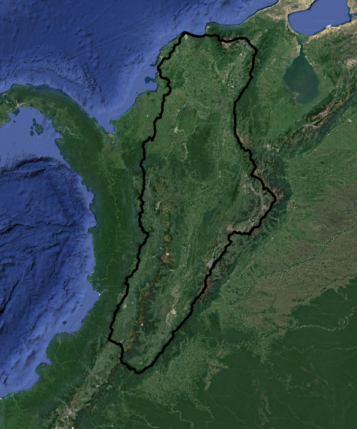

# DSModel: Statistical Downscaling Models

DSModel downscales climate-model output (for example MPI-ESM-MR CMIP5 daily files) to weather stations with machine-learning regressors. For each station it finds the climate-model grid cell, learns the relation between the model value and the station value of the same day in a calibration period, and applies it to the later days of the model (the scenario period).

| Method | Key | Scikit-learn estimator |
|---|---|---|
| k-nearest neighbours | `knn` | `KNeighborsRegressor` |
| Random forest | `forest` | `RandomForestRegressor` |
| Linear regression | `linear` | `Ridge` |
| Multi-layer perceptron | `mlp` | `MLPRegressor` |

The case study region is the Magdalena River Basin, Colombia.



## Status

| Part | Status |
|---|---|
| Station table, catalogue and NetCDF readers (`dsmodel.io`) | tested; NetCDF reader also checked on an MPI-ESM-MR file |
| k-NN, random forest, ridge, MLP with the legacy grids (`dsmodel.models`) | tested on synthetic data |
| Calibration, validation and application for one station (`dsmodel.pipeline`) | tested on synthetic data |
| Run over a whole catalogue, CSV and plot output (`dsmodel.runner`) | tested on synthetic data |
| Run notebook (`notebooks/run_dsmodel.ipynb`) | runs end to end on the synthetic demo |

**What has not been verified.** There is no reference output from the original scripts in this repository, so the port was not compared number by number with the legacy code. It is checked on synthetic data (a relation that is known) and its NetCDF reader on one real model file. Tests run on Python 3.12 locally and on 3.11 and 3.12 in GitHub Actions. See `docs/LEGACY_NOTES.md` for what was found in the original code and which choices the package makes.

## Installation

DSModel needs **Python 3.11 or newer**.

```bash
git clone https://github.com/sduarte09/DSModel.git
cd DSModel
pip install -e ".[test]"
```

Classic NetCDF files (such as CMIP5 daily files) are read with SciPy. For NetCDF4/HDF5 files, install the optional reader: `pip install -e ".[netcdf]"`.

## Quick start

Try it on a small synthetic dataset first (random data, only to see the workflow):

```python
from dsmodel import demo, run_catalog

args = demo.make_demo_dataset("demo_data")
result = run_catalog(output_folder="output", methods=("knn", "linear"), **args)
print(result.validation)
```

With your own data:

```python
from dsmodel import run_catalog

result = run_catalog(
    station_data="stations.csv",        # Date (dd/mm/yyyy) + one column per station ID
    station_catalog="catalog.csv",      # ID, Latitud, Longitud
    model_historic="gcm/historical/",   # folder with the .nc files of the historic experiment
    model_rcp="gcm/rcp45/",             # folder with the .nc files of the scenario experiment
    output_folder="output/",
    cal_date="2005-12-31",              # last day of calibration
    val_date="2012-12-31",              # last day of validation (optional)
    app_date="2100-12-31",              # last day of the application
    methods=("knn", "forest", "linear"),
)
```

For one station:

```python
from dsmodel import downscale_station, io

model = io.read_cell_series(nc_files, *io.locate_cell(*io.read_grid(nc_files[0]), 4.6, -74.1))
result = downscale_station(station_series, model, cal_end="2005-12-31", app_end="2100-12-31", method="knn")
result.series      # observations up to cal_end, predictions after
result.best_params
```

Or open `notebooks/run_dsmodel.ipynb`.

### Input and output

- **Stations:** a CSV (or Excel) file with a `Date` column in `dd/mm/yyyy` and one column per station ID. Missing days can be empty.
- **Catalogue:** a CSV (or Excel) file with `ID`, `Latitud` and `Longitud` (`Latitude`/`Longitude` also work). Negative longitudes are converted to 0-360.
- **Model:** folders with daily NetCDF files. Precipitation (`pr`) is converted from kg m-2 s-1 to mm/day and temperature (`tas`, `tasmin`, `tasmax`) from K to degrees C.
- **Output:** one CSV per method (`<method>_<model>_<variable>_<experiment>.csv`), a validation table, and an annual plot per station and method.

## Repository layout

```
src/dsmodel/   Python 3 package
tests/         pytest tests on synthetic data
notebooks/     run_dsmodel.ipynb
legacy/        the original scripts, unchanged (DSMethods/, Statistical Downscaling Models.py, notebook, extras/)
docs/          notes on the legacy code, Magdalena.png
```

## Tests

```bash
pytest
```

## License

MIT, see `LICENSE`.
